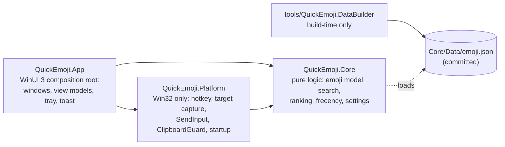
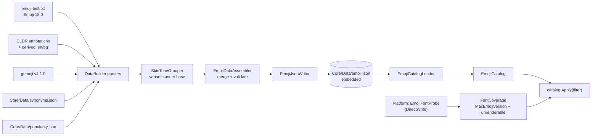
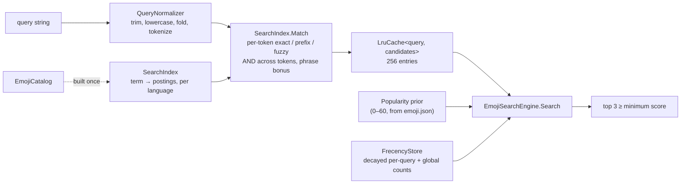
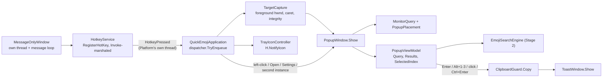
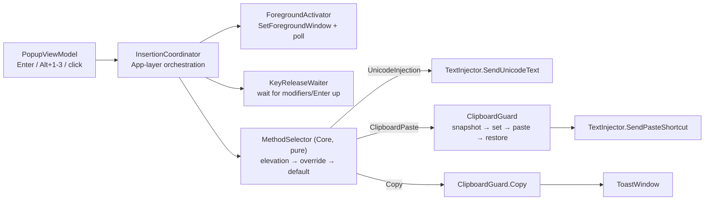
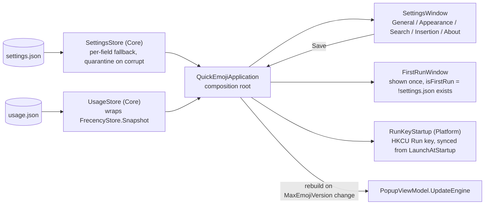

# Architecture

QuickEmoji is three layers with one-way dependencies. This document grows with each stage; Stage 7 adds the insertion sequence diagram.

## Rules
- Core references nothing project-local and nothing Windows-specific. File access goes through an abstraction.
- Platform holds Win32 interop (CsWin32) and no UI types.
- App is thin: it wires Core and Platform together and owns all UI.
- DataBuilder is the only component allowed to use the network (the opt-in semantic-model download in SPEC §3.7 is the single runtime exception).

## Emoji data pipeline (Stage 1)

- Sources are joined on a VS16-free key, but the stored string is always the exact fully-qualified sequence from emoji-test.txt. Nothing in the pipeline rewrites an emoji string.
- DataBuilder re-loads its output through `EmojiCatalogLoader` and refuses to write unless every fully-qualified sequence survives exactly once.
- At startup the app loads the catalog (about 50 ms cold), measures font coverage (about 25 ms), and applies the filter. **Stage 5** wires this in (see docs/DECISIONS.md: it was built in Stage 1 but not actually connected to the running app until then — a real gap, found and fixed while wiring Settings' "max emoji version" override, which needed the same code path).

## Search engine (Stage 2)

- `SearchIndex` is immutable and built once from the catalog; `EmojiSearchEngine` owns one per process (via `App`/`Core` composition, wired in Stage 3).
- The LRU cache holds lexical candidates only (not popularity or frecency), so a `RecordUse` changes the next search immediately without invalidating any cache entry.
- `RankingWeights` is the single source of every scoring constant (SPEC's own rule); `docs/DECISIONS.md` records where Stage 2's tuning departs from SPEC's literal numbers and why.
- `tests/data/ranking-golden.tsv` is the contract: 184 cases, 100% top-1 and 100% top-3-set.

## Hotkey, popup, tray (Stage 3)

- `MessageOnlyWindow` owns a dedicated background thread and message loop; `RegisterHotKey`/`UnregisterHotKey` must run on that exact thread (`ERROR_WINDOW_OF_OTHER_THREAD` otherwise), so `HotkeyService` marshals onto it via `MessageOnlyWindow.Invoke`. See docs/DECISIONS.md for two real bugs found building this (a private-message collision with `WM_CREATE`, and the thread-affinity requirement itself).
- `HotkeyService.HotkeyPressed` fires on Platform's own thread, not the UI thread — Platform has no WinUI dependency, so App marshals to its `DispatcherQueue` itself.
- `TargetContext` is captured synchronously inside the hotkey handler — the only moment the foreground window is guaranteed to be the one the user was typing into (SPEC §4.1).
- `PopupWindow` and `ToastWindow` are each created once at startup and shown/hidden thereafter (never re-created — SPEC's 50 ms budget depends on this). Both use `WindowChrome.ApplyRoundedCorners` (a direct `DwmSetWindowAttribute` call Platform exposes, since WinUI 3 has no managed API for it on a borderless window) and `DesktopAcrylicBackdrop` with a solid-color fallback.
- `ClipboardGuard` takes an `IClipboard`; `SystemClipboard` is the real WinRT implementation, used only by the running app (it needs the WinUI app's own STA thread — see docs/DECISIONS.md).
- Stage 3's commit path is copy-to-clipboard-and-toast for every keymap action (Enter, Alt+1-3, click, Ctrl+Enter); Stage 4 gives Enter/Alt+N/click real insertion while Ctrl+Enter stays copy-only, per SPEC §2.

## Insertion engine (Stage 4)

- `MethodSelector` is pure Core logic (elevated/unknown target always forces Copy — SendInput into an elevated process fails *silently*, so this must be decided before attempting injection, never inferred from a failed attempt); everything either side of it is Platform (Win32) or App (orchestration).
- The clipboard-paste path snapshots the clipboard, sets the emoji, sends the paste shortcut, waits `ClipboardRestoreDelay`, then restores the snapshot only if the clipboard's sequence number is still what it was right after the set (SPEC §4.3) — otherwise something else changed it meanwhile and restoring would clobber that.
- The FlaUI E2E tests (`NotepadTests`) exercise this whole path against a real Notepad window and caught a real production bug doing so (`PopupWindow.Show` never actually took keyboard focus) — see docs/DECISIONS.md's Stage 4 section.

## Settings, startup, first run, personalization (Stage 5)

- `AppSettings`/`SettingsStore`/`UsageStore`/`SkinToneApplier` live in Core (pure, no Windows types), per CLAUDE.md's layout table ("settings model/persistence" is a Core responsibility). `AppSettings` uses its own `HotkeySetting`/`PopupPosition`/`AppTheme` types rather than Platform's — Core may not reference Platform even for a Win32-free type — and `App.Settings.HotkeyGestureMapping` converts between them at the one boundary that needs both.
- `SettingsStore`/`UsageStore` parse into a loosely-typed `JsonObject` and validate each field independently, rather than deserializing straight into a POCO, specifically so one invalid field falls back to its own default instead of failing the whole load (SPEC §7).
- The popup is still never recreated (Stage 3's rule): a Settings save updates `PopupViewModel.Settings` in place and, if the font-filtered catalog needs rebuilding (the "max emoji version" override changed), swaps the search engine via `PopupViewModel.UpdateEngine` rather than replacing the window.
- `RunKeyStartup` uses the managed `Microsoft.Win32.Registry` API directly — it is already a BCL wrapper, not raw Win32 interop, so CLAUDE.md's CsWin32 rule does not apply to it.

## Startup (Stage 0)
`Program.Main` parses the command line, configures Serilog (`%LOCALAPPDATA%\QuickEmoji\logs`, 7 × 1 MB, shared across the brief overlap a second single-instance launch can create), creates the `SingleInstanceGuard` (SPEC §8), then starts WinUI with a `DispatcherQueueSynchronizationContext`. `QuickEmojiApplication.OnLaunched` wires the catalog, search engine, hotkey, popup, toast, tray, settings/usage persistence, and (Stage 5) first-run detection together. `--startup-check` exits as soon as the full composition is up — Stage 5 extended this check to also construct and close the Settings and first-run windows, since a XAML parse/binding error only surfaces when a real WinUI window is actually built.
