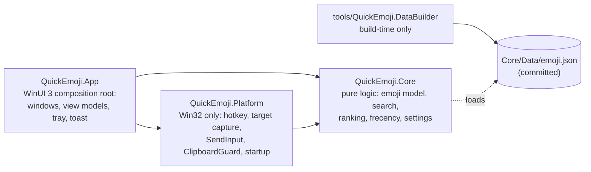
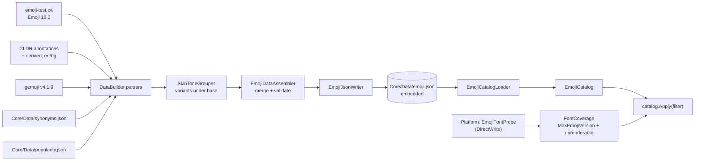
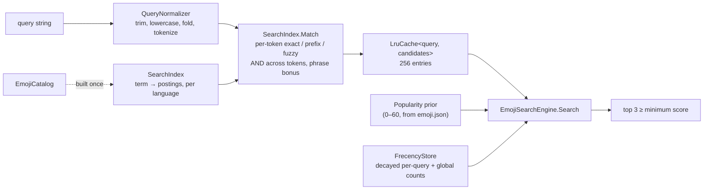

# Architecture

QuickEmoji is three layers with one-way dependencies. This document grows with each stage; Stage 7 adds the insertion sequence diagram.

## Rules
- Core references nothing project-local and nothing Windows-specific. File access goes through an abstraction.
- Platform holds Win32 interop (CsWin32) and no UI types.
- App is thin: it wires Core and Platform together and owns all UI.
- DataBuilder is the only component allowed to use the network (the opt-in semantic-model download in SPEC §3.7 is the single runtime exception).

## Emoji data pipeline (Stage 1)

- Sources are joined on a VS16-free key, but the stored string is always the exact fully-qualified sequence from emoji-test.txt. Nothing in the pipeline rewrites an emoji string.
- DataBuilder re-loads its output through `EmojiCatalogLoader` and refuses to write unless every fully-qualified sequence survives exactly once.
- At startup the app loads the catalog (about 50 ms cold), measures font coverage (about 25 ms), and applies the filter. Stage 3 wires this in, off the UI thread.

## Search engine (Stage 2)

- `SearchIndex` is immutable and built once from the catalog; `EmojiSearchEngine` owns one per process (via `App`/`Core` composition, wired in Stage 3).
- The LRU cache holds lexical candidates only (not popularity or frecency), so a `RecordUse` changes the next search immediately without invalidating any cache entry.
- `RankingWeights` is the single source of every scoring constant (SPEC's own rule); `docs/DECISIONS.md` records where Stage 2's tuning departs from SPEC's literal numbers and why.
- `tests/data/ranking-golden.tsv` is the contract: 184 cases, 100% top-1 and 100% top-3-set.

## Startup (Stage 0)
`Program.Main` parses the command line, configures Serilog (`%LOCALAPPDATA%\QuickEmoji\logs`, 7 × 1 MB), then starts WinUI with a `DispatcherQueueSynchronizationContext`. `QuickEmojiApplication.OnLaunched` creates the window. `--startup-check` exits as soon as initialisation finishes.
