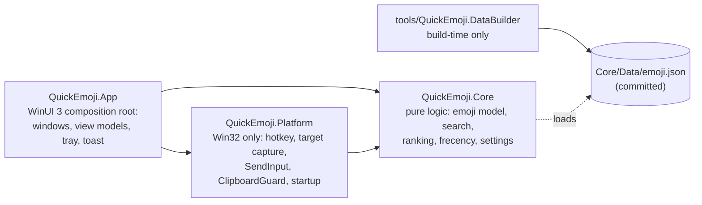

# Architecture

QuickEmoji is three layers with one-way dependencies. This document grows with each stage; Stage 7 adds the insertion sequence diagram.

## Rules
- Core references nothing project-local and nothing Windows-specific. File access goes through an abstraction.
- Platform holds Win32 interop (CsWin32) and no UI types.
- App is thin: it wires Core and Platform together and owns all UI.
- DataBuilder is the only component allowed to use the network (the opt-in semantic-model download in SPEC §3.7 is the single runtime exception).

## Startup (Stage 0)
`Program.Main` parses the command line, configures Serilog (`%LOCALAPPDATA%\QuickEmoji\logs`, 7 × 1 MB), then starts WinUI with a `DispatcherQueueSynchronizationContext`. `QuickEmojiApplication.OnLaunched` creates the window. `--startup-check` exits as soon as initialisation finishes.
